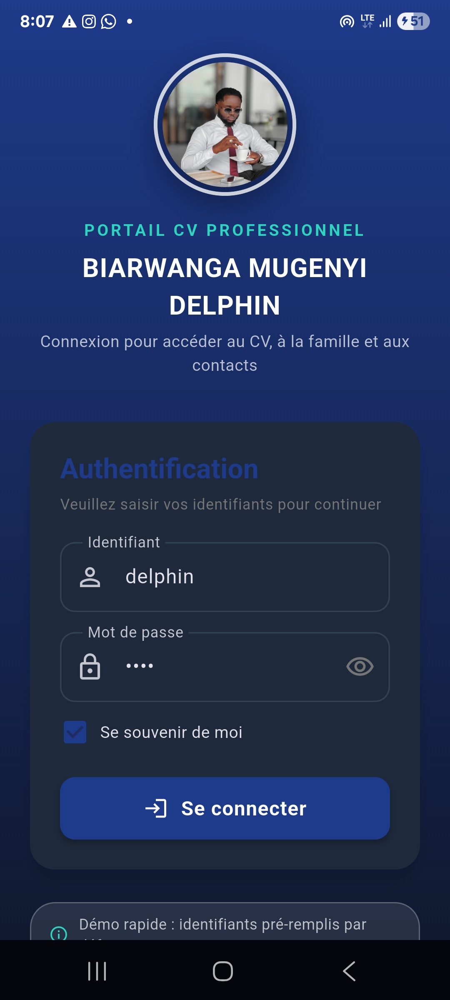
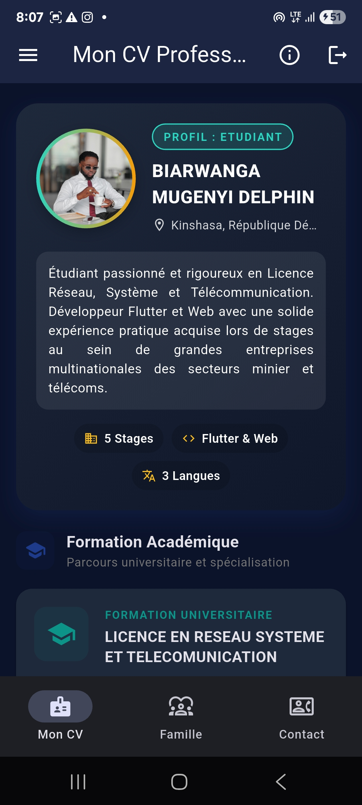
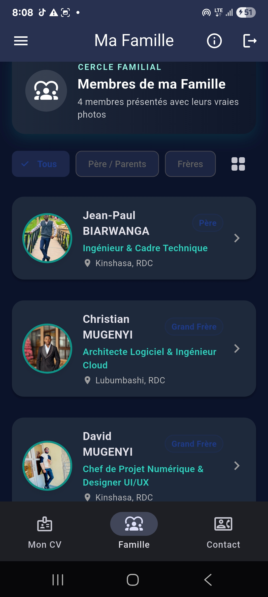
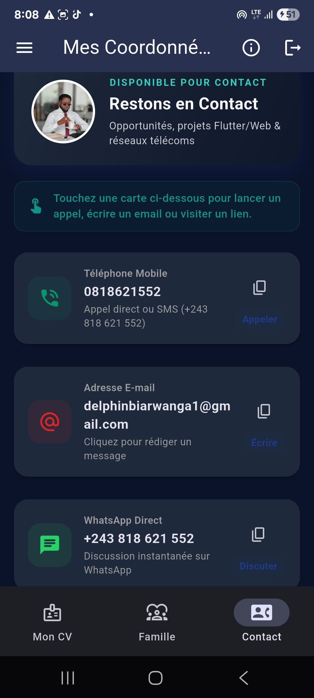
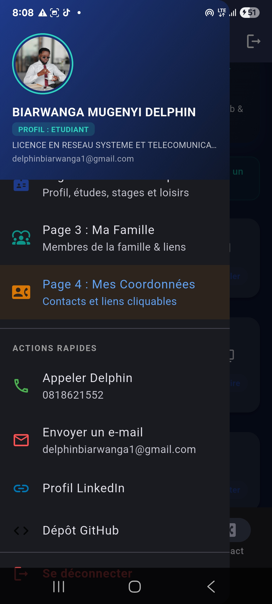
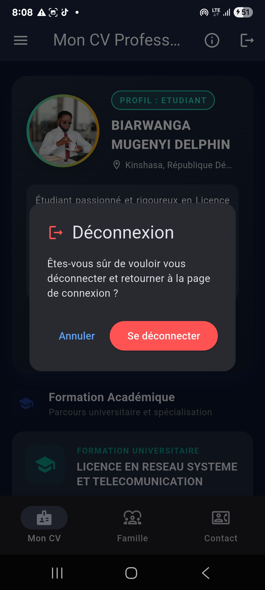

# 📱 CV Mobile Flutter — BIARWANGA MUGENYI DELPHIN

<p align="center">
  
</p>

<p align="center">
  <strong>BIARWANGA MUGENYI DELPHIN</strong><br>
  <em>Profil : ÉTUDIANT</em><br>
  <strong>Formation : LICENCE EN RÉSEAU SYSTÈME ET TÉLÉCOMMUNICATION</strong><br>
  Kinshasa, République Démocratique du Congo
</p>

<p align="center">
  
  
  
  
  
</p>

---

## 🎬 Vidéo de Démonstration

Voici la vidéo de démonstration de mon application mobile développée avec **Flutter** :

<p align="center">
  <a href="https://drive.google.com/file/d/1yMxKRQte45RKYpFMi6vLf_kpyTWyXD6k/view?usp=drive_link" target="_blank">
    
  </a>
</p>

---

## 📸 Aperçu de l'Application (Captures d'Écran)

Voici les captures d'écran de l'application en cours d'exécution :

<table align="center">
  <tr>
    <td align="center" width="33%">
      <strong>Page 1 : Connexion</strong><br><br>
      
    </td>
    <td align="center" width="33%">
      <strong>Page 2 : Accueil & Profil CV</strong><br><br>
      
    </td>
    <td align="center" width="33%">
      <strong>Page 2 : Stages & Compétences</strong><br><br>
      
    </td>
  </tr>
  <tr>
    <td align="center" width="33%">
      <strong>Page 3 : Cercle Familial</strong><br><br>
      
    </td>
    <td align="center" width="33%">
      <strong>Page 3 : Détail Membre</strong><br><br>
      
    </td>
    <td align="center" width="33%">
      <strong>Page 4 : Contacts Cliquables</strong><br><br>
      
    </td>
  </tr>
</table>

---

## 🌟 Fonctionnalités Détaillées

### 1️⃣ Page (1) : Connexion Sécurisée (`LoginScreen`)
- Formulaire d'authentification complet avec :
  - Champ **Identifiant** avec icône utilisateur.
  - Champ **Mot de passe masqué** avec bascule interactive pour afficher/masquer la saisie.
  - Bouton **« Se connecter »** avec animation et vérification de saisie.
  - Option "Se souvenir de moi" et identifiants pré-remplis (`delphin` / `1234`) pour une démonstration rapide.

### 2️⃣ Page (2) : Accueil & CV Complet (`CVHomeScreen`)
- **En-tête de Profil :**
  - Véritable photo de profil de Delphin.
  - Nom complet : **BIARWANGA MUGENYI DELPHIN**.
  - Statut : **ETUDIANT**.
  - Synthèse statistique adaptative (5 Stages, Flutter & Web, 3 Langues) sans aucun bug d'affichage.
- **Formation Universitaire :**
  - **LICENCE EN RESEAU SYSTEME ET TELECOMUNICATION** avec détail des spécialisations (Réseaux IP, Systèmes d'exploitation, Télécommunications, Cybersécurité).
- **Expériences en Entreprise (5 Stages) :**
  - 🏛️ **KIBALI GOLD MINE** : Télécoms & Réseaux Industriels minières.
  - 💻 **Global Technology** : Administration Systèmes & Réseaux d'entreprise.
  - 📡 **VODACOM** : Ingénierie Réseaux Mobiles & GSM/3G/4G.
  - 📶 **AIRTEL** : Infrastructure & Faisceaux Hertziens.
  - 🌐 **ORANGE** : Réseaux IP & Solutions Entreprises.
- **Projet Réalisé :**
  - 🏫 **Application de Gestion d'une École** : Système complet multiplateforme (gestion des inscriptions, suivi des notes, comptabilité et emplois du temps).
- **Compétences Techniques :**
  - Développeur FLUTTER (Dart, Provider/MVVM, Material 3, API REST).
  - Développement Web (HTML5, CSS3, JavaScript, Responsive Design).
  - Réseaux & Télécoms (Routage Cisco/MikroTik, Linux, Windows Server, Téléphonie IP).
- **Compétences Linguistiques :**
  - Français (Courant / Professionnel).
  - Lingala (Langue maternelle / Courant).
  - Anglais (Intermédiaire / Technique).
- **Centres d'intérêt :**
  - 🥊 **Boxe** : Discipline et endurance.
  - ⚽ **Football** : Esprit d'équipe et stratégie.
  - 🏐 **Volleyball** : Agilité et dynamisme collectif.
  - 🔬 **Les Recherches** : Veille IA, Cloud et Télécommunications du futur.
  - 📖 **Lire / Lecture** : Sciences, technologie et développement personnel.

### 3️⃣ Page (3) : Cercle Familial (`FamilyScreen`)
- Présentation de la famille avec les **vraies photos** intégrées en local (`assets/images/`) :
  - **Jean-Paul BIARWANGA** (Père — Ingénieur & Cadre Technique).
  - **Christian MUGENYI** (Grand Frère — Architecte Cloud & DevOps).
  - **David MUGENYI** (Grand Frère / Cousin — Chef de Projet & UI/UX).
  - **Samuel BIARWANGA** (Frère Cadet — Étudiant en Sciences & Robotique).
- Filtres dynamiques : *Tous*, *Père / Parents*, *Frères*.
- Double affichage : Vue **Liste (`ListView`)** ou Vue **Grille (`GridView`)**.
- Fiche modale détaillée au tap avec possibilité de lancer un appel.

### 4️⃣ Page (4) : Coordonnées Cliquables (`ContactScreen`)
Toutes les coordonnées interagissent avec le système via `url_launcher` :
- 📞 **Téléphone (`0818621552`)** : Lance immédiatement l'application Téléphone.
- ✉️ **E-mail (`delphinbiarwanga1@gmail.com`)** : Ouvre le composeur de courriel.
- 💬 **WhatsApp (`+243818621552`)** : Ouvre une discussion directe sur WhatsApp.
- 💼 **LinkedIn** : Redirige vers le profil professionnel en ligne.
- 🐙 **GitHub** : Ouvre le profil et les dépôts de code de Delphin.
- 📋 Bouton de copie rapide dans le presse-papier avec notification visuelle SnackBar.
- 📨 Formulaire de message direct pour contacter Delphin en un clic.

### 🧭 Navigation
- **NavigationBar Material 3** : Barre inférieure moderne pour basculer facilement entre les 3 pages principales.
- **Drawer Latéral** : Menu latéral avec bannière personnalisée, raccourcis d'actions rapides et bouton de **Déconnexion** avec confirmation.

---

## 📂 Structure du Répertoire

```text
cv_flutter_biarwanga_mugenyi_delphin/
├── assets/
│   └── images/
│       ├── profile.jpg          # Photo de profil de Delphin
│       ├── family_1.jpg         # Photo du frère cadet
│       ├── family_2.jpg         # Photo du grand frère
│       ├── family_3.jpg         # Photo du père
│       └── family_4.jpg         # Photo du grand frère / cousin
├── pictures/                    # Captures d'écran de démonstration pour le README
│   ├── Screenshot_20261119_200728.jpg
│   ├── Screenshot_20261119_200737.jpg
│   ├── Screenshot_20261119_200818.jpg
│   ├── Screenshot_20261119_200828.jpg
│   ├── Screenshot_20261119_200836.jpg
│   └── Screenshot_20261119_200848.jpg
├── lib/
│   ├── main.dart                # Point d'entrée de l'application
│   ├── theme/
│   │   └── app_theme.dart       # Configuration du thème Material 3 (Clair & Sombre)
│   ├── models/
│   │   ├── cv_data.dart         # Données du CV (stages, projets, compétences, hobbies)
│   │   └── family_member.dart   # Modèle de données pour les membres de la famille
│   ├── services/
│   │   └── url_launcher_service.dart # Service d'appel, d'envoi d'email et d'ouverture d'URLs
│   └── screens/
│       ├── login_screen.dart    # Page 1 : Connexion
│       ├── main_navigation_screen.dart # Navigation Scaffold (BottomBar + Drawer)
│       ├── cv_home_screen.dart  # Page 2 : CV complet
│       ├── family_screen.dart   # Page 3 : Cercle familial
│       └── contact_screen.dart  # Page 4 : Coordonnées cliquables
├── test/
│   └── widget_test.dart         # Tests automatisés
├── pubspec.yaml                 # Dépendances (url_launcher, cupertino_icons, assets)
└── README.md                    # Documentation complète avec photos